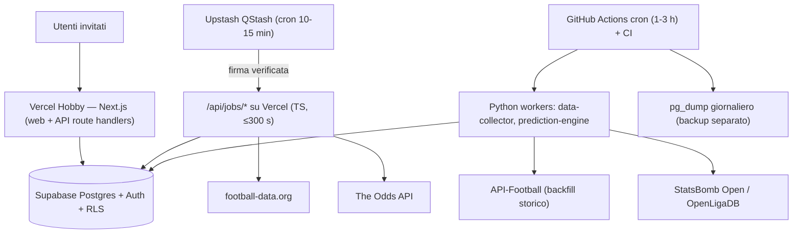

# PREDICTRA — Milestone 0: audit e piano tecnico

**Stato:** PROPOSTA — in attesa di approvazione  
**Data verifica fonti:** 7 novembre 2026  
**Riferimento:** `PREDICTRA_PROMPT_MASTER.md` v1.0, §27 "Primo compito da eseguire"

> Nessuna risorsa cloud è stata creata, nessun servizio esterno attivato, nessuna API key richiesta.
> Tutti i dati di piani e limiti qui sotto sono stati letti dalle pagine ufficiali il 7/11/2026.
> Quello che non è stato possibile verificare è marcato **NON VERIFICATO**. I provider cambiano i piani spesso: va riverificato prima di ogni milestone.

---

## 1. Stato effettivo del repository

| Voce              | Stato                                                                                     |
| ----------------- | ----------------------------------------------------------------------------------------- |
| Repository        | `predictra-hq/predictra`. È **privato**: l'API GitHub senza autenticazione risponde 404.  |
| Branch remoti     | `main` e `dev`, entrambi al commit `f38547c Initial commit`                               |
| Contenuto         | solo `README.md` (`# predictra`)                                                          |
| Codice esistente  | nessuno, quindi non c'è nulla da preservare o migrare                                     |
| Branch protection | **NON VERIFICATO**: `gh` non è installato, va controllata da GitHub → Settings → Branches |

**Strategia di branch.** Il prompt prevede `main` / `develop` / `feature/*`. Il repo usa già `dev`. Proposta: **`dev` = integrazione** (equivale a `develop`), `main` = produzione, `feature/*` partono da `dev`, con PR obbligatorie verso `dev` e `main`.

### Toolchain locale (PC Windows)

| Strumento         | Stato                                              | Necessario per                                                                   |
| ----------------- | -------------------------------------------------- | -------------------------------------------------------------------------------- |
| Node.js           | v26.13.0 ✅                                        | web, API, tooling                                                                |
| npm               | 11.20.0 ✅                                         | —                                                                                |
| pnpm              | ❌ non installato. Si attiva con `corepack enable` | monorepo workspaces                                                              |
| Python            | ❌ **non installato**                              | prediction-engine, data-collector, test quantitativi                             |
| git               | 2.56 ✅                                            | —                                                                                |
| GitHub CLI (`gh`) | ❌                                                 | PR, branch protection, secrets (facoltativo)                                     |
| Supabase CLI      | ❌                                                 | migrazioni locali, test RLS                                                      |
| Docker            | ❌                                                 | Postgres locale per test RLS/migrazioni. In alternativa si usa un Postgres in CI |

L'esecuzione in produzione **non** dipende dal PC: la toolchain locale serve solo allo sviluppo.

---

## 2. Matrice provider dati calcistici

Legenda: ✅ disponibile sul piano gratuito · 💰 solo a pagamento · ❌ assente · ❓ NON VERIFICATO

### 2.1 Provider × categoria di dato (piano gratuito)

| Provider                      | Costo/limiti free                                         | Calendario/risultati         | Classifiche | Formazioni         | Stat. squadra (tiri, corner, cartellini)                                                                                  | xG                          | Giocatori           | Quote                                                     | Storico                                                                         |
| ----------------------------- | --------------------------------------------------------- | ---------------------------- | ----------- | ------------------ | ------------------------------------------------------------------------------------------------------------------------- | --------------------------- | ------------------- | --------------------------------------------------------- | ------------------------------------------------------------------------------- |
| **football-data.org**         | €0, 10 chiamate/min, nessun limite giornaliero dichiarato | ✅ (punteggi "delayed")      | ✅          | 💰 (Deep Data €29) | 💰 (Statistic add-on €15)                                                                                                 | ❓                          | 💰                  | 💰 (Odds add-on €15)                                      | ❓ (10 stagioni solo nel piano a €29)                                           |
| **API-Football (API-Sports)** | €0, 100 richieste/giorno, ~10/min                         | ✅ **solo stagioni passate** | ✅          | ✅                 | ✅                                                                                                                        | ❓                          | ✅ (prime 3 pagine) | ✅ pre-match e live                                       | ⚠️ **solo stagioni Y-4…Y-2 (2022–2024)**: nessun accesso alla stagione in corso |
| **The Odds API**              | €0, **500 crediti/mese**                                  | ✅ (scores, 1–2 crediti)     | ❌          | ❌                 | ❌                                                                                                                        | ❌                          | ❌                  | ✅ (vedi 2.3)                                             | 💰 (storico quote solo a pagamento)                                             |
| **StatsBomb Open Data**       | gratis (GitHub)                                           | ✅ (stagioni selezionate)    | ❌          | ✅                 | ✅ eventi completi                                                                                                        | ✅ (negli eventi; campo ❓) | ✅                  | ❌                                                        | stagioni sparse (vedi 2.2)                                                      |
| **OpenLigaDB**                | gratis, senza autenticazione, limiti ❓                   | ✅                           | ❓          | ❌                 | ❌                                                                                                                        | ❌                          | ❌                  | ❌                                                        | ❓                                                                              |
| **football-data.co.uk** (CSV) | gratis                                                    | ✅ dal 1993/94               | —           | ❌                 | ✅ tiri, tiri in porta, corner, falli, cartellini (dal 2000/01; tutte le 22 divisioni dal 2017/18). xG "dove disponibile" | parziale                    | ❌                  | ✅ storico 1X2, O/U 2.5, AH, **closing odds** dal 2019/20 | ✅ ricchissimo                                                                  |

Le pagine prezzi e documentazione di API-Football hanno risposto HTTP 403 al fetch automatico. I dati sopra vengono dalla ricerca sulle pagine ufficiali api-football.com e api-sports.io e vanno confermati dalla dashboard dopo la registrazione.

### 2.2 Provider × competizione (piano gratuito)

| Competizione       | football-data.org | API-Football            | The Odds API                                                                 | StatsBomb Open               | OpenLigaDB     | football-data.co.uk |
| ------------------ | ----------------- | ----------------------- | ---------------------------------------------------------------------------- | ---------------------------- | -------------- | ------------------- |
| Serie A            | ✅                | ✅ (solo stag. passate) | ✅ `soccer_italy_serie_a`                                                    | 1986/87, 2015/16             | ❓             | ✅                  |
| Premier League     | ✅                | ✅ (passate)            | ✅                                                                           | 2003/04, 2015/16             | ✅ `pl`        | ✅                  |
| La Liga            | ✅                | ✅ (passate)            | ✅                                                                           | 2004/05–2020/21              | ✅ `la1`       | ✅                  |
| Bundesliga         | ✅                | ✅ (passate)            | ✅                                                                           | 2015/16, 2023/24             | ✅ `bl1`       | ✅                  |
| Ligue 1            | ✅                | ✅ (passate)            | ✅                                                                           | 2015/16, 2021–23             | ❓             | ✅                  |
| Primeira Liga      | ✅                | ✅ (passate)            | ✅                                                                           | ❌                           | ❓             | ✅                  |
| Eredivisie         | ✅                | ✅ (passate)            | ✅                                                                           | ❌                           | ❓             | ✅                  |
| Belgian Pro League | ❌                | ✅ (passate)            | ✅                                                                           | ❌                           | ❓             | ✅                  |
| Champions League   | ✅                | ✅ (passate)            | ✅                                                                           | fino al 2018/19              | ✅ `ucl`       | ❌                  |
| Europa League      | ❌                | ✅ (passate)            | ✅                                                                           | solo 1988/89                 | ✅             | ❌                  |
| Conference League  | ❌                | ✅ (passate)            | ✅                                                                           | ❌                           | ✅             | ❌                  |
| Coppe nazionali    | ❌                | ✅ (passate)            | ✅ (Coppa Italia, FA Cup, DFB-Pokal, Copa del Rey, Coupe de France, EFL Cup) | parziale                     | DFB-Pokal      | ❌                  |
| Nazionali          | Mondiali, Europei | ✅ (passate)            | Mondiali, Nations League                                                     | Mondiali, Euro, Copa América | Nations League | ❌                  |

### 2.3 The Odds API: dettaglio quote

- **Costo:** 1 credito per mercato per regione e per chiamata. `/sports` e `/events` sono gratuiti.
- **Bookmaker italiani:** solo **Codere (IT)** e **Unibet (IT)**, nella regione `eu`. La regione `it` non esiste. Sisal, Snai, Lottomatica e bet365 IT non sono presenti.
- **Altri bookmaker EU:** Pinnacle, Betfair Exchange, 1xBet, Marathonbet, Betsson, Tipico, William Hill, Betclic e altri. Servono **solo come riferimento statistico**: non sono necessariamente autorizzati in Italia.
- **Mercati calcio:** `h2h` (1X2) è affidabile. Per spreads/totals la pagina dice "mainly available for US sports". BTTS, double chance, draw no bet, corner, cartellini e risultato esatto esistono come chiavi, ma la popolazione effettiva per i bookmaker EU è **NON VERIFICATA**. I player props valgono solo per bookmaker USA.
- **Termini:** consentiti conservazione indefinita, visualizzazione (anche commerciale), addestramento modelli e valori derivati. Vietato rivendere o ridistribuire i dati come prodotto a sé. L'attribuzione non è obbligatoria.

### 2.4 Licenze e termini d'uso: punti critici

| Fonte                   | Esito                                                                                                                                                                                                                                                                                                                                                                                                                                                 |
| ----------------------- | ----------------------------------------------------------------------------------------------------------------------------------------------------------------------------------------------------------------------------------------------------------------------------------------------------------------------------------------------------------------------------------------------------------------------------------------------------- |
| The Odds API            | ✅ compatibile con l'uso previsto                                                                                                                                                                                                                                                                                                                                                                                                                     |
| OpenLigaDB              | ✅ ODbL: obbligo di attribuzione e share-alike sul database derivato, da gestire                                                                                                                                                                                                                                                                                                                                                                      |
| StatsBomb Open          | ⚠️ "research projects and genuine interest in football analytics". Attribuzione e logo StatsBomb obbligatori se si pubblicano analisi. LICENSE.pdf **non letto** (NON VERIFICATO)                                                                                                                                                                                                                                                                     |
| football-data.org       | ❓ termini d'uso non letti: da verificare prima dell'integrazione                                                                                                                                                                                                                                                                                                                                                                                     |
| API-Football            | ❓ termini non letti (403)                                                                                                                                                                                                                                                                                                                                                                                                                            |
| **football-data.co.uk** | ⛔ **Bloccante.** Il testo dice che l'uso è "intended for private individuals only", e vieta "commercial or data training products using automated bots/scrapers/AI". Uso consentito: "league match prediction only". L'uso privato a fini di previsione sembra rientrare, ma il download automatico e l'addestramento di modelli in una piattaforma multiutente sono in zona grigia. **Proposta: non usarlo senza un consenso scritto del gestore.** |

---

## 3. Matrice hosting / database / worker / scheduler (free tier)

| Servizio                          | Limiti free verificati                                                                                                                          | Ruolo proposto                                                         | Note critiche                                                                                                                                                                                   |
| --------------------------------- | ----------------------------------------------------------------------------------------------------------------------------------------------- | ---------------------------------------------------------------------- | ----------------------------------------------------------------------------------------------------------------------------------------------------------------------------------------------- |
| **Supabase Free**                 | 500 MB DB, 5 GB egress, 50k MAU, 1 GB storage, 2 progetti attivi, MFA base (TOTP) incluso, SMTP custom incluso, 500k invocazioni Edge Functions | Postgres + Auth + RLS                                                  | ⚠️ **Pausa dopo 1 settimana di inattività**: l'agente schedulato la impedisce. ⚠️ **Nessun backup automatico** nel piano free. Limite email/ora dello SMTP integrato e pg_cron: NON VERIFICATI  |
| **Vercel Hobby**                  | funzioni fino a 300 s, 1M invocazioni/mese, 4 h CPU attiva/mese, 100 GB transfer, cron **solo giornalieri** (±59 min)                           | Next.js web + API                                                      | ⚠️ Solo "personal, non-commercial use": va bene finché PREDICTRA resta privata e senza ricavi. Non si può acquistare uso extra. Non collegabile a repo di organizzazioni GitHub                 |
| **GitHub Actions (repo privato)** | $12/mese di compute incluso, circa **2.000 min Linux 2-core**. Cron con minimo 5 min, con ritardi o salti nelle ore di punta                    | CI + worker Python schedulati (raccolta dati, modelli)                 | Al termine del credito l'uso si blocca (nessun addebito senza metodo di pagamento). Lo schedule gira solo sul branch di default. Auto-disable dopo 60 giorni documentato solo per repo pubblici |
| **Upstash QStash Free**           | 1.000 messaggi/giorno, 10 schedule attivi, 10 code, risposta HTTP fino a 15 min, DLQ 3 giorni                                                   | Scheduler fine (ogni 10–15 min) che chiama endpoint protetti su Vercel | Ogni retry consuma un messaggio                                                                                                                                                                 |
| Upstash Redis Free                | 250 MB, 500k comandi/mese                                                                                                                       | facoltativo: rate limit / lock                                         | Evitabile usando Postgres                                                                                                                                                                       |
| Cloudflare Workers Free           | 100k richieste/giorno, **10 ms CPU** per richiesta/cron, 5 cron, Queues 10k op/giorno                                                           | non scelto                                                             | 10 ms di CPU non bastano per i modelli e non c'è Python                                                                                                                                         |
| Render Free                       | web service in sleep dopo 15 min, 750 h/mese. **Niente worker né cron gratuiti**. Postgres free scade dopo 30 giorni                            | non scelto                                                             | Inadatto a un agente continuo                                                                                                                                                                   |

**Conclusione: con budget zero non esiste un worker sempre attivo.** L'agente funziona a cicli schedulati, con frequenza dichiarata.

---

## 4. Funzionalità non realizzabili gratis (o senza dati adeguati)

| Funzione richiesta                                                                                         | Problema                                                                                                            | Degradazione proposta                                                                                                                                                |
| ---------------------------------------------------------------------------------------------------------- | ------------------------------------------------------------------------------------------------------------------- | -------------------------------------------------------------------------------------------------------------------------------------------------------------------- |
| Dati stagione corrente oltre calendario/risultati (formazioni, statistiche, cartellini, corner, giocatori) | football-data.org free dà solo calendario, risultati e classifiche. API-Football free non vede la stagione in corso | Mercati corner, cartellini, tiri, marcatori e giocatori: **NON VALUTABILI** in v1. Si attivano con un piano a pagamento (football-data €29+€15, oppure API-Football) |
| Europa League, Conference League, Belgio, coppe nazionali (calendari correnti)                             | assenti nel free di football-data.org                                                                               | Quote e calendario da The Odds API (events gratuito, risultati a crediti); modello limitato per mancanza di storico affidabile                                       |
| Quote dei bookmaker italiani principali                                                                    | solo Codere IT e Unibet IT                                                                                          | Mostrare la copertura reale; gli altri bookmaker solo come riferimento                                                                                               |
| Mercati oltre 1X2 (O/U, BTTS, handicap) dalle quote                                                        | popolazione EU non verificata, crediti scarsi                                                                       | v1: quote **1X2**. Le probabilità di O/U, BTTS e risultato esatto possono uscire dal modello (Poisson/Dixon-Coles) anche senza quota, ma senza EV                    |
| Aggiornamento quote frequente                                                                              | 500 crediti/mese ≈ 16/giorno                                                                                        | Snapshot 1X2 sulle 8 leghe principali una volta al giorno, più un refresh mirato nelle ore prima delle partite in budget. Stato FRESH/STALE sempre visibile          |
| Live updates / in-play                                                                                     | nessuna fonte live gratuita adeguata                                                                                | **Disattivato** e dichiarato                                                                                                                                         |
| Closing odds e CLV                                                                                         | storico quote solo a pagamento. football-data.co.uk ha licenza bloccante                                            | CLV calcolato solo sui propri snapshot pre-match, dichiarato come approssimato                                                                                       |
| Backup automatici                                                                                          | Supabase Free non li ha                                                                                             | `pg_dump` giornaliero via GitHub Actions su storage separato (es. release asset privato o bucket gratuito), con test di restore                                      |
| Agente "continuo"                                                                                          | nessun worker always-on gratuito                                                                                    | Cicli: QStash ogni 15 min (job leggeri TS), GitHub Actions ogni 1–3 h (job Python)                                                                                   |
| Ask PREDICTRA (chat LLM)                                                                                   | nessun LLM gratuito garantito                                                                                       | Rinviata o con chiave a pagamento previa approvazione. **Mai** per generare numeri                                                                                   |
| Email (inviti, verifica, reset)                                                                            | Supabase SMTP integrato con limiti bassi (NON VERIFICATO)                                                           | SMTP gratuito esterno (es. Resend o Brevo free, **da verificare**) oppure inviti manuali in fase iniziale                                                            |

**Storico per l'addestramento dei modelli.** La fonte legale più solida è API-Football free (stagioni 2022–2024, 100 richieste/giorno), da scaricare gradualmente con un backfill di qualche settimana. A questa si aggiungono i risultati football-data.org. Se il backfill risulta insufficiente, un primo modello Elo/Poisson si costruisce sui soli risultati, che sono la fonte più ampia e meno costosa.

---

## 5. Architettura minima sostenibile (costo €0)

Decisioni chiave:

1. **Coda e lock su Postgres.** Tabella `agent_jobs` con `SELECT … FOR UPDATE SKIP LOCKED`, chiave di idempotenza unica, `attempts`, `next_run_at` per il backoff e stato `dead` come dead-letter. Si usa `pg_try_advisory_lock` per i lock. Nessun servizio di coda in più.
2. **Due runtime di lavoro.** TypeScript su Vercel per i job leggeri e frequenti (polling quote/fixture, freshness, notifiche). Python su GitHub Actions per i job pesanti (backfill, feature, modelli, backtest). Entrambi leggono e scrivono la stessa coda.
3. **Heartbeat.** Ogni run scrive `agent_runs`. La dashboard mostra l'ultimo ciclo riuscito e segnala l'agente come "degradato" oltre una soglia.
4. **Recupero dopo interruzioni.** I job sono deterministici per (tipo, entità, finestra temporale). Al riavvio lo scheduler ricrea solo le finestre mancanti e i job già completati vengono saltati tramite l'idempotency key.
5. **Segreti.** Variabili d'ambiente Vercel e GitHub Secrets. La service role key resta solo server-side, mai `NEXT_PUBLIC_`.
6. **Ambienti.** `local` (Postgres in CI/Docker), `staging` (secondo progetto Supabase free, poi preview Vercel), `production`. Supabase free consente 2 progetti attivi, cioè staging + prod.

### Budget di compute stimato (da validare in M7)

| Voce                                                                      | Stima                                                                         |
| ------------------------------------------------------------------------- | ----------------------------------------------------------------------------- |
| QStash: 1 schedule ogni 15 min                                            | 96 msg/giorno, più retry, ≪ 1.000                                             |
| GitHub Actions: job Python ogni 3 h, circa 3 min                          | 8 × 3 × 30 ≈ **720 min/mese**                                                 |
| GitHub Actions: CI (lint, test, build) circa 6 min a push, ~100 push/mese | ≈ 600 min                                                                     |
| GitHub Actions: backup giornaliero, circa 2 min                           | ≈ 60 min                                                                      |
| **Totale GHA**                                                            | ≈ 1.400 / ~2.000 min disponibili. Margine stretto: Windows e macOS da evitare |
| The Odds API: 8 leghe × 1X2 × 1 regione al giorno                         | 240 crediti/mese, più ~250 per refresh pre-partita                            |

---

## 6. Milestone, dipendenze e criteri di completamento

| #     | Milestone                                                                                                                                                                  | Dipende da                    | Criteri di completamento (estratto)                                                                                                                                                       |
| ----- | -------------------------------------------------------------------------------------------------------------------------------------------------------------------------- | ----------------------------- | ----------------------------------------------------------------------------------------------------------------------------------------------------------------------------------------- |
| **0** | Audit e piano (questo documento)                                                                                                                                           | —                             | Piano approvato. Decisioni D1–D8 prese                                                                                                                                                    |
| **1** | Fondazioni: monorepo pnpm/turbo, Next.js + Tailwind + shadcn, tema Dark Premium, i18n (it), Supabase (Auth, inviti, ruoli, 2FA TOTP, RLS), migrazioni, dashboard shell, CI | M0, account Supabase e Vercel | Il Super Admin invita via email, l'utente si registra con 2FA, sospensione e revoca funzionano. Test RLS e isolamento verdi in CI. Lint, typecheck e build verdi. Nessun segreto nel repo |
| **2** | Football data: modello canonico, adapter football-data.org e API-Football (backfill), mapping e alias, data quality gate, pannello Source Intelligence                     | M1, API key gratuite          | Partite reali con provider, `observed_at` e stato qualità. Test degli adapter con fixture registrate. Health dei provider visibile                                                        |
| **3** | Statistiche e quote: adapter The Odds API, `odds_snapshots`, margine e probabilità implicite, Market Intelligence                                                          | M2                            | Quote 1X2 con timestamp e FRESH/STALE. Test overround e de-margin. Copertura dichiarata                                                                                                   |
| **4** | Prediction engine (Python): baseline, Elo, Poisson/Dixon-Coles, calibrazione, backtest temporale, versioning, explainability, Confidence Score                             | M2 (storico)                  | Brier e Log Loss migliori della baseline out-of-sample. Leakage check. Probabilità coerenti (somme, complementi, AH push). Riproducibilità                                                |
| **5** | Bet Builder: combinazioni, correlazioni (stessa partita → probabilità congiunta dal modello), ranking multidimensionale, categorie, versioni                               | M3, M4                        | Nessuna schedina forzata. Correlazioni gestite o combinazione esclusa. Versioni immutabili                                                                                                |
| **6** | Bankroll e tracker: bankroll per utente, movimenti, real bets, metriche, flat/Kelly frazionario limitato, limiti personali                                                 | M1, M4                        | Isolamento RLS testato. Admin senza accesso ai bankroll altrui. Simulations e Real Bets distinte                                                                                          |
| **7** | Agente autonomo: coda Postgres, QStash, GHA, retry, backoff, DLQ, heartbeat, polling adattivo, notifiche dashboard, recovery                                               | M2–M5                         | Test di idempotenza e restart. Frequenza reale dichiarata in UI                                                                                                                           |
| **8** | Hardening e produzione: security review, backup e restore testato, accessibilità, runbook, deploy prod                                                                     | tutte                         | Criteri §23.3 e §26 soddisfatti                                                                                                                                                           |

### Rischi principali

| Rischio                                                                             | Impatto                                          | Mitigazione                                                                           |
| ----------------------------------------------------------------------------------- | ------------------------------------------------ | ------------------------------------------------------------------------------------- |
| Dati free insufficienti per la stagione corrente (niente formazioni né statistiche) | Alto: limita mercati e qualità                   | Mercati non valutabili dichiarati. Upgrade mirato dei dati come prima eventuale spesa |
| Cambi di piano dei provider (es. API-Football riduce le stagioni)                   | Medio                                            | Adapter indipendenti, health check, riverifica a ogni milestone                       |
| Budget GitHub Actions esaurito                                                      | Medio: l'agente si ferma fino al mese successivo | Monitorare i minuti, cadenza adattiva, solo runner Linux                              |
| Pausa del progetto Supabase                                                         | Basso con agente attivo                          | Heartbeat giornaliero                                                                 |
| Nessun backup nativo                                                                | Alto                                             | `pg_dump` giornaliero più restore test mensile                                        |
| Uso "commerciale" su Vercel Hobby                                                   | Medio se il progetto evolve                      | Restare privati e senza ricavi, altrimenti Vercel Pro                                 |
| Licenze dati (football-data.co.uk, StatsBomb)                                       | Alto (legale)                                    | Esclusione o consenso scritto. Attribuzioni gestite                                   |
| Scarsità di quote IT                                                                | Medio                                            | Copertura dichiarata. Bookmaker esteri solo come riferimento                          |

---

## 7. Decisioni richieste per approvare

| ID  | Decisione                    | Proposta                                                                                                                                                           |
| --- | ---------------------------- | ------------------------------------------------------------------------------------------------------------------------------------------------------------------ |
| D1  | Branch di integrazione       | Usare `dev` esistente al posto di `develop`                                                                                                                        |
| D2  | Stack hosting                | Vercel Hobby + Supabase Free (2 progetti: staging, prod) + GitHub Actions + Upstash QStash Free                                                                    |
| D3  | Fonti v1                     | football-data.org (corrente), API-Football free (backfill storico), The Odds API free (1X2). StatsBomb e OpenLigaDB come secondari                                 |
| D4  | football-data.co.uk          | **Escluso** salvo consenso scritto del gestore                                                                                                                     |
| D5  | Mercati v1                   | 1X2, Doppia chance, DNB, O/U, Goal/No Goal, risultato esatto dal modello gol. EV solo dove esiste una quota. Corner, cartellini, tiri e giocatori "non valutabili" |
| D6  | Live updates e Ask PREDICTRA | Disattivati in v1                                                                                                                                                  |
| D7  | Email transazionali          | Provider SMTP gratuito da verificare in M1, oppure SMTP Supabase per i primi utenti                                                                                |
| D8  | Account cloud                | Gli account (Supabase, Vercel, Upstash, provider dati) li crei **tu**. Le chiavi vanno solo nei secret, mai in chat o nel repo                                     |
| D9  | Toolchain locale             | Installare Python 3.12+, abilitare pnpm (`corepack enable`), facoltativi Supabase CLI e `gh`                                                                       |

---

## 8. Fonti consultate (7/11/2026)

- football-data.org — https://www.football-data.org/pricing , https://www.football-data.org/coverage
- API-Football — https://www.api-football.com/pricing (403 al fetch; dati da ricerca), https://www.api-football.com/news/post/how-to-get-started-with-api-football-the-complete-beginners-guide , https://api-sports.io/sports/football
- The Odds API — https://the-odds-api.com/#get-access , https://the-odds-api.com/sports-odds-data/sports-apis.html , https://the-odds-api.com/sports-odds-data/bookmaker-apis.html , https://the-odds-api.com/sports-odds-data/betting-markets.html , https://the-odds-api.com/terms-and-conditions.html
- StatsBomb Open Data — https://github.com/statsbomb/open-data
- OpenLigaDB — https://www.openligadb.de/
- football-data.co.uk — https://www.football-data.co.uk/data.php , https://www.football-data.co.uk/notes.txt
- Supabase — https://supabase.com/pricing , https://supabase.com/docs/guides/platform/billing-on-supabase
- Vercel — https://vercel.com/pricing , https://vercel.com/docs/limits , https://vercel.com/docs/cron-jobs/usage-and-pricing , https://vercel.com/docs/limits/fair-use-guidelines
- GitHub Actions — https://docs.github.com/en/billing/managing-billing-for-your-products/managing-billing-for-github-actions/about-billing-for-github-actions , https://docs.github.com/en/actions/writing-workflows/choosing-when-your-workflow-runs/events-that-trigger-workflows#schedule
- Render — https://render.com/docs/free
- Cloudflare — https://developers.cloudflare.com/workers/platform/pricing/ , https://developers.cloudflare.com/workers/platform/limits/
- Upstash — https://upstash.com/pricing/qstash , https://upstash.com/pricing/redis
